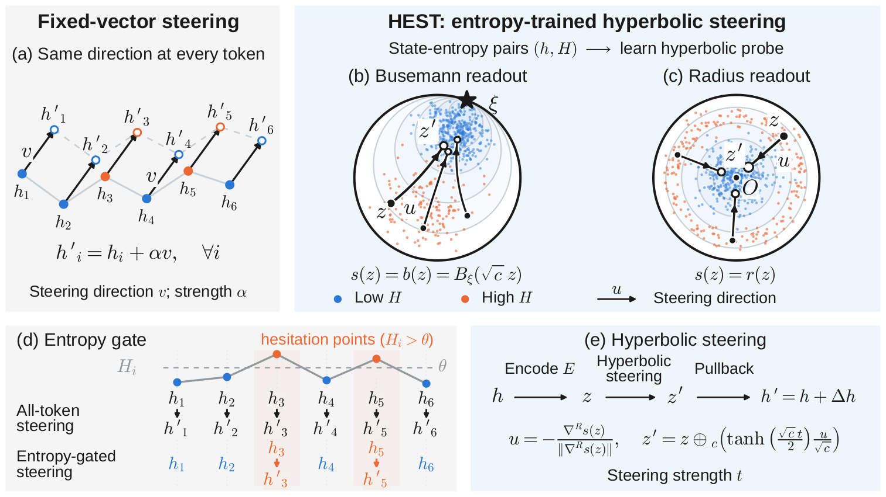

# HEST: Hyperbolic Entropy Steering

Code for the paper **Hesitation Has a Geometry: Entropy-Trained Hyperbolic Probes for Sparse Activation Steering**
by [Zeyong Zhang](https://zeyong98.github.io/), [Tung Sum Thomas Kwok](https://thomask1018.github.io/), [Tengfei Ma](https://sbu-ma.github.io/)
and [Mengjia Xu](https://gracexu182.github.io/).

[**arXiv**](https://arxiv.org/abs/2610.02391) &nbsp;|&nbsp; [**PDF**](https://arxiv.org/pdf/2610.02391) &nbsp;|&nbsp; [**Project page**](https://zeyong98.github.io/HEST/)

<p align="center">
  
</p>

HEST steers a language model's mathematical reasoning only at the tokens where the model itself hesitates. An
entropy gate on the next-token distribution fires, the KV cache is rolled back by one position, a small geodesic step
in a hyperbolic probe of the residual stream is applied to the state of the token just read, and the token is
re-decoded. The probe is trained on the model's own next-token entropies and needs no answer labels.

## Main results

Accuracy (%) with greedy decoding, HEST (Busemann readout, t = 0.5; radius readout, t = 0.25) and CAA, and the median
percentage of tokens that HEST steers per solution (Table 2 of the paper).

| Model | Dataset | Greedy | HEST, Busemann | HEST, radius | CAA | Steered (%) |
|---|---|---|---|---|---|---|
| Qwen2.5-Math-1.5B-Instruct | MATH-500 | 74.20 | **76.00** (+1.80) | 75.20 (+1.00) | 70.00 (-4.20) | 1.1 |
| Qwen2.5-Math-1.5B-Instruct | GSM8K | 84.84 | **85.37** (+0.53) | 84.53 (-0.30) | 84.23 (-0.61) | 1.6 |
| Llama-3.1-8B-Instruct | MATH-500 | 50.80 | **52.00** (+1.20) | 51.00 (+0.20) | 38.20 (-12.60) | 0.8 |
| Llama-3.1-8B-Instruct | GSM8K | **84.61** | 84.31 (-0.30) | 84.53 (-0.08) | 80.06 (-4.55) | 3.0 |
| Qwen2.5-Math-7B-Instruct | MATH-500 | 84.00 | **84.80** (+0.80) | 84.20 (+0.20) | 82.60 (-1.40) | 1.0 |
| Qwen2.5-Math-7B-Instruct | GSM8K | 95.38 | **95.60** (+0.23) | 95.45 (+0.08) | 95.00 (-0.38) | 2.0 |

## Installation

Python 3.11, PyTorch 2.8 (CUDA 12.8), transformers 5.5.

```
pip install -r requirements.txt
```

Models are loaded by their Hugging Face ids (`Qwen/Qwen2.5-Math-1.5B-Instruct`, `Qwen/Qwen2.5-Math-7B-Instruct`,
`meta-llama/Llama-3.1-8B-Instruct`; the last one is gated). Two environment variables select the model and the steered
layer: `CX_MODEL` and `CX_LAYER` (19 for the Qwen models, 13 for Llama). All commands are run from the repository
root; outputs go to `outputs/`.

## Repository structure

```
HEST/
├── README.md                 # this file
├── REPRODUCE.md              # full pipeline, commands for every table of the paper, glossary
├── LICENSE                   # MIT
├── CITATION.cff
├── requirements.txt          # Python dependencies
├── hest/                     # the method
│   ├── probe.py              # hyperbolic probe: encoder, Poincare ball, Busemann and radius readouts
│   ├── field.py              # geodesic step and its pullback to the residual stream
│   ├── decoding.py           # greedy decoding with the entropy gate and cache rollback
│   ├── config.py             # dataset paths and the output directory
│   ├── evaluation/           # the unified grading protocol (judge_unified.py)
│   └── third_party/          # Qwen2.5-Math evaluation toolkit (answer normalisation, symbolic equivalence; MIT)
├── scripts/                  # one step each: collect_states, train_probe, calibrate_threshold,
│   │                         #   build_caa, run_eval, make_splits, match_step_size
│   └── analysis/             # the scripts that produce the tables of the paper
├── configs/                  # one JSON config per run: greedy/, main/, caa/, ablation/
├── data/                     # MATH-500, GSM8K, OlympiadBench, training subsets, id lists
│   └── checkpoints/          # released probes (Qwen2.5-Math-1.5B, layer 19, Busemann readout) and two CAA vectors
└── docs/                     # the project page (GitHub Pages)
```

## Quick start

The released MATH-500 probe on five problems (two of them are corrected by the steering step), the greedy baseline on
the same problems, and the grading:

```
CX_MODEL=Qwen/Qwen2.5-Math-1.5B-Instruct CX_LAYER=19 python scripts/run_eval.py --config configs/main/qwen1.5b_math500_busemann_t0.5.json --ids data/ids/smoke_math5.json --data math500 --tag _c3 --max-new 3072
CX_MODEL=Qwen/Qwen2.5-Math-1.5B-Instruct CX_LAYER=19 python scripts/run_eval.py --config configs/greedy/greedy.json --ids data/ids/smoke_math5.json --data math500 --tag _c3 --max-new 3072
python scripts/analysis/table1_main.py --tags c3 --judge unified --safeguard
```

Runs are resumable: the same command with `--ids all` decodes the remaining problems. The full pipeline (training
states, probe, gate threshold, steered runs), the commands behind every table of the paper, and a glossary from the
paper's terms to the code are in [REPRODUCE.md](REPRODUCE.md).

## Citation

```bibtex
@article{zhang2026hesitation,
  title={Hesitation Has a Geometry: Entropy-Trained Hyperbolic Probes for Sparse Activation Steering},
  author={Zhang, Zeyong and Kwok, Tung Sum Thomas and Ma, Tengfei and Xu, Mengjia},
  journal={arXiv preprint arXiv:2610.02391},
  year={2026}
}
```

## License

MIT (`LICENSE`). `hest/third_party/qwen_math_eval/` is from the
[Qwen2.5-Math](https://github.com/QwenLM/Qwen2.5-Math/tree/main/evaluation) evaluation toolkit under its own MIT
license; its only modification is the `latex2sympy2_extended` import, marked in `grader.py` and `parser.py`.

This work was supported by the DOE SEA-CROGS project (DE-SC0023191) and the AFOSR project (FA9550-24-1-0231).
